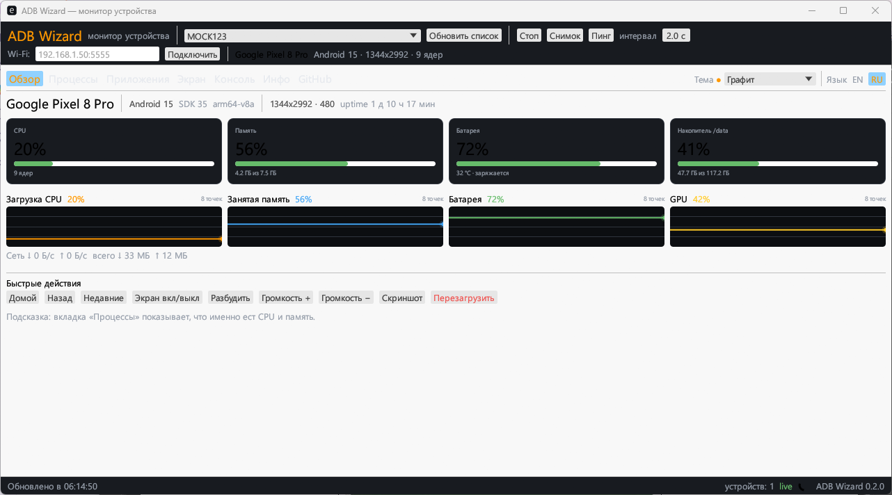
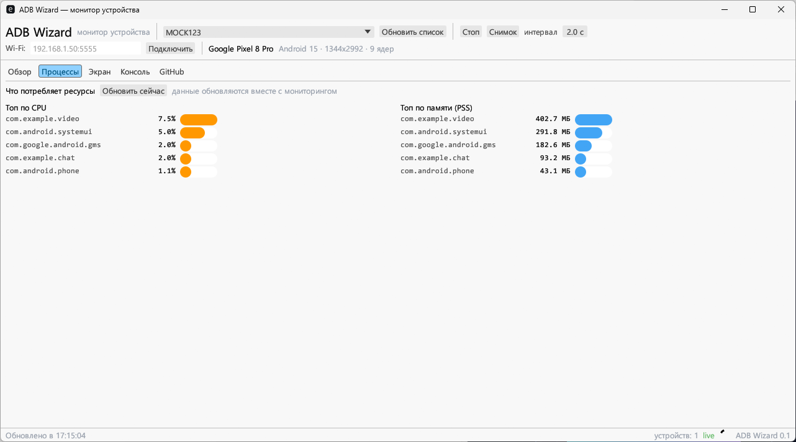
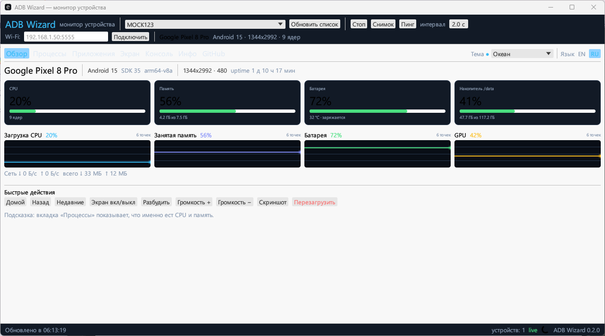
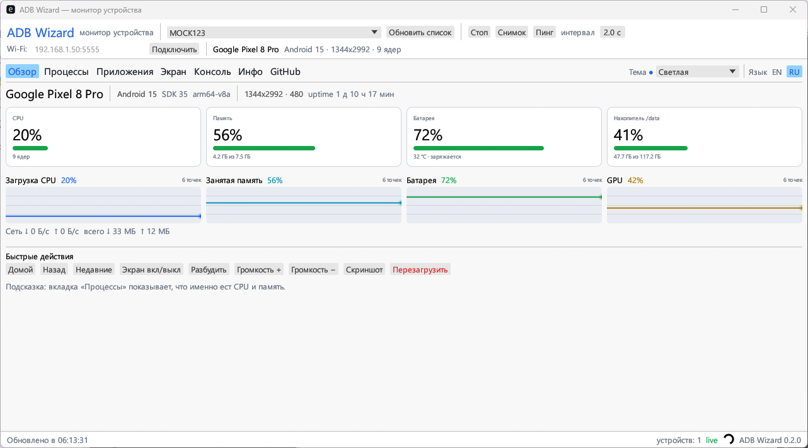
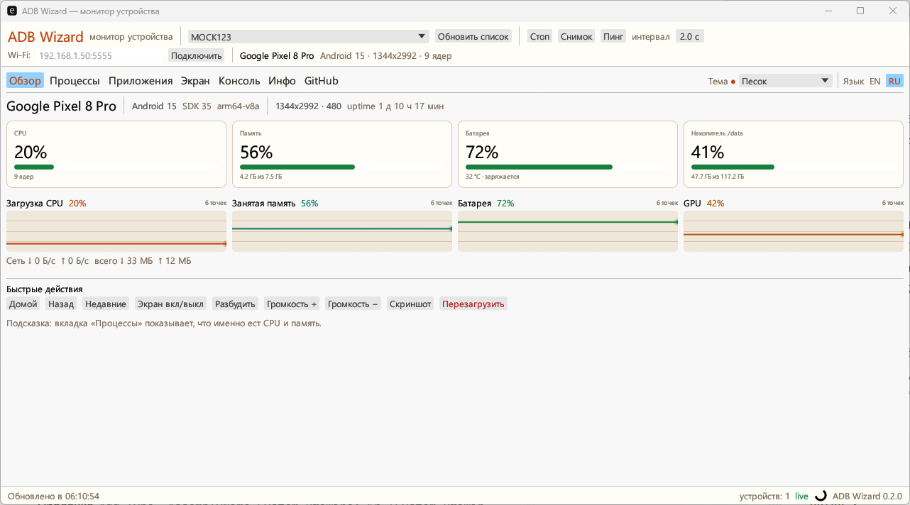
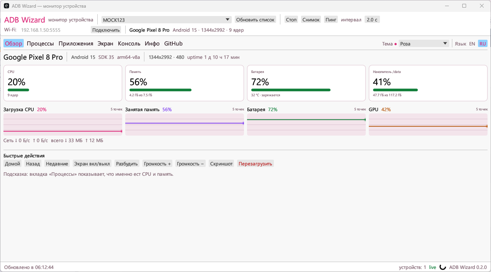

<div align="center">

# ⚡ ADB Wizard

**Android device monitor over ADB — CPU, apps, live screen and shell in one window.**

[](https://github.com/AmazingCoderA/adb-wizard/releases/latest)
[](https://github.com/AmazingCoderA/adb-wizard/actions/workflows/ci.yml)
[](https://www.rust-lang.org/)
[](https://github.com/emilk/egui)
[](LICENSE)

[Русская версия](README.ru.md) · [Features](#-features) · [Themes](#-themes) · [Quick start](#-quick-start) · [Publishing](#-publishing-to-github)

</div>

---

**ADB Wizard** is a lightweight native Rust app that shows what is happening on an Android device right now: CPU load, memory, battery, storage, network, top processes, the phone screen with tap control, and an `adb shell` console. No web UI and no heavy runtime — a single executable.



> Screenshots use a demo device (mock ADB), not a real phone.

## 📥 Download

| OS | File |
|---|---|
| **Windows 10/11** (x86_64) | [adb-wizard-windows-x86_64.exe](https://github.com/AmazingCoderA/adb-wizard/releases/latest/download/adb-wizard-windows-x86_64.exe) |
| **Linux** (x86_64) | [adb-wizard-linux-x86_64](https://github.com/AmazingCoderA/adb-wizard/releases/latest/download/adb-wizard-linux-x86_64) |
| **macOS** (Apple Silicon) | [adb-wizard-macos-aarch64](https://github.com/AmazingCoderA/adb-wizard/releases/latest/download/adb-wizard-macos-aarch64) |

All builds are produced by GitHub Actions from the tagged source. macOS builds target Apple Silicon; Intel macOS builds are not provided yet.

## ✨ Features

| | |
|---|---|
| 📊 **Overview** | Real CPU load from `/proc/stat` deltas (guest ticks excluded, smoothed), GPU load from sysfs where available, RAM, battery level/temperature/status, `/data`, uptime, network throughput and live sparklines |
| 🔥 **Processes** | Top CPU consumers (`dumpsys cpuinfo`) and top memory consumers (`dumpsys meminfo`, PSS) with bars |
| 📦 **Apps** | User app list with search; open system app settings, force stop, clear data, disable/enable, uninstall, and read `dumpsys package` info |
| 📱 **Screen** | Live screen streaming (150–3000 ms interval), tap-to-control, Home/Back/Recents, save PNG |
| 🎛️ **Custom buttons** | Add/edit/remove your own buttons with any `adb shell` command; presets for Play/Pause, Menu, Camera, volume |
| ⌨️ **Console** | Full `adb shell` with output history and quick commands (battery, memory, packages, logs, properties, disk, top CPU) |
| 🧾 **Tech info** | `getprop`, `ip addr`, `df`, `uname`, battery, display and CPU info in one dump |
| 📶 **Ping** | ADB round-trip and device-to-internet ping (`8.8.8.8`) with one click |
| 🚀 **GitHub** | Publish the project with one button through GitHub CLI (`gh`) |
| 🎨 **Themes & languages** | Five accent palettes and a Russian/English UI switch |



## 🎨 Themes

Switch themes in the top-right corner of the tab row. The accent color drives the title, active tab, charts, process bars and primary buttons.

| Theme | Accent | Mood |
|---|---|---|
| **Graphite** | `#FF9800` orange | warm dark interface, default |
| **Ocean** | `#38BDF8` sky blue | cool dark blue |
| **Emerald** | `#34D399` mint green | calm dark green |
| **Violet** | `#A78BFA` lavender | high-contrast purple |
| **Light** | `#2563EB` blue | bright theme for daylight |
| **Sand** | `#C2410C` burnt orange | warm light beige |
| **Mint** | `#059669` green | light mint |
| **Rose** | `#DB2777` pink | light rose |

<p align="center">
  
  
</p>
<p align="center">
  
  
</p>

## 🚀 Quick start

### Prebuilt binary

1. Download the archive or executable for your OS from [Releases](https://github.com/AmazingCoderA/adb-wizard/releases/latest).
2. Make sure `adb` is available in `PATH` (or set the `ADB` environment variable).
3. Connect the phone over USB with USB debugging enabled and start the app.

### From source

```bash
git clone https://github.com/AmazingCoderA/adb-wizard.git
cd adb-wizard
cargo run --release
```

The binary appears in `target/release/`.

If `adb` is not in `PATH`, point to it explicitly:

```powershell
$env:ADB = "C:\platform-tools\adb.exe"
cargo run --release
```

```bash
export ADB=/opt/android-sdk/platform-tools/adb
cargo run --release
```

## 📋 Requirements

- **Windows 10/11**, **Linux** (X11/Wayland) or **macOS** (Apple Silicon).
- **Rust** stable, edition 2021.
- **[Android SDK Platform-Tools](https://developer.android.com/tools/releases/platform-tools)** — `adb` in `PATH`.
- On the phone: Developer options → USB debugging, then confirm the key on the computer.
- For publishing: [Git](https://git-scm.com/downloads) and [GitHub CLI](https://cli.github.com/) authorized via `gh auth login`.

Linux build dependencies (Debian/Ubuntu):

```bash
sudo apt-get install libxcb-render0-dev libxcb-shape0-dev libxcb-xfixes0-dev \
  libxkbcommon-dev libgl1-mesa-dev
```

## 🕹️ Usage

1. Connect the phone over USB and enable debugging.
2. Start the app — the device appears in the list and monitoring starts automatically.
3. **Processes** shows what is eating CPU and memory.
4. **Apps** lets you search, inspect and manage user applications.
5. **Screen** streams the phone screen; enable **Tap control** to click through to the device.
6. **Info** loads a full technical dump and can ping the device and the internet.
7. **Console** runs any `adb shell` command, for example `dumpsys battery` or `logcat -d -t 200`.
8. **GitHub** publishes the project in one click.

### 📶 Wi-Fi connection

Once over USB:

```bash
adb tcpip 5555
```

Then enter `PHONE_IP:5555` in the app and press **Connect**. The phone and computer must be on the same network. On Android 11+ wireless debugging may require `adb pair`.

## 🐙 Publishing to GitHub

Tab **GitHub** → repository name → **Publish to GitHub**.

What the button does:

1. `git init -b main` if the repository does not exist yet.
2. `git add -A` and commit.
3. `gh repo create <name> --public/--private --source . --remote origin --push`.
4. Shows the link to the created repository.

Authorization, either way:

- run `gh auth login` once in a terminal;
- paste a Personal Access Token with the `repo` scope into the **GitHub token** field (the token is kept in memory only).

The app looks for `gh` in `PATH`, `%LOCALAPPDATA%\Programs\GitHub CLI\bin\gh.exe`, `%ProgramFiles%\GitHub CLI` and next to the executable. If `gh` is missing, the app still prepares a local git repository and prints instructions. The **Create token** button opens GitHub with the `repo` scope preselected.

## 🧱 Project layout

```
src/
  main.rs      — window and viewport setup
  app.rs       — egui UI, themes, tabs and application state
  adb.rs       — adb invocation, snapshots, screenshots, background monitor
  parsers.rs   — Android output parsers + unit tests
  i18n.rs      — Russian/English strings
  publish.rs   — git/gh publishing
.github/
  workflows/ci.yml      — test and build on Windows, Linux and macOS
  workflows/release.yml — multi-OS release assets on tag push
```

## 🩺 Troubleshooting

- **adb not found** — add platform-tools to `PATH` or set `ADB`.
- **unauthorized** — confirm the debugging prompt on the phone screen.
- **offline** — reconnect the cable, run `adb kill-server` and `adb start-server`.
- **No CPU/memory data** — some firmware restricts `dumpsys`; try the commands manually in **Console**.
- **Screenshot fails** — the app automatically falls back to the `/sdcard` method.
- **Screen blinking after a command** — check whether a custom button or console command toggles the screen (`input keyevent 26`), and report the exact command in an issue.

## 📄 License

[MIT](LICENSE)
