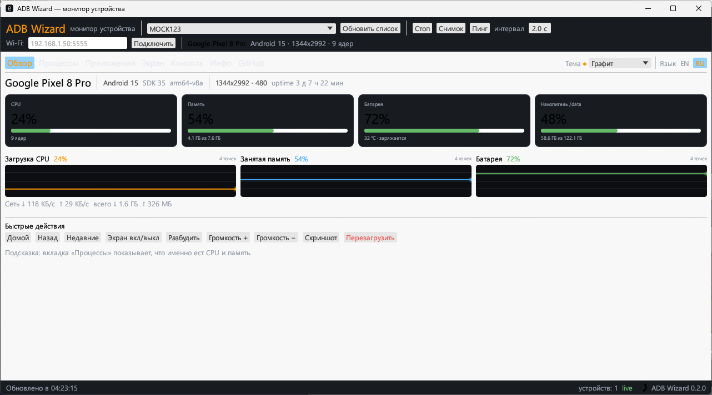
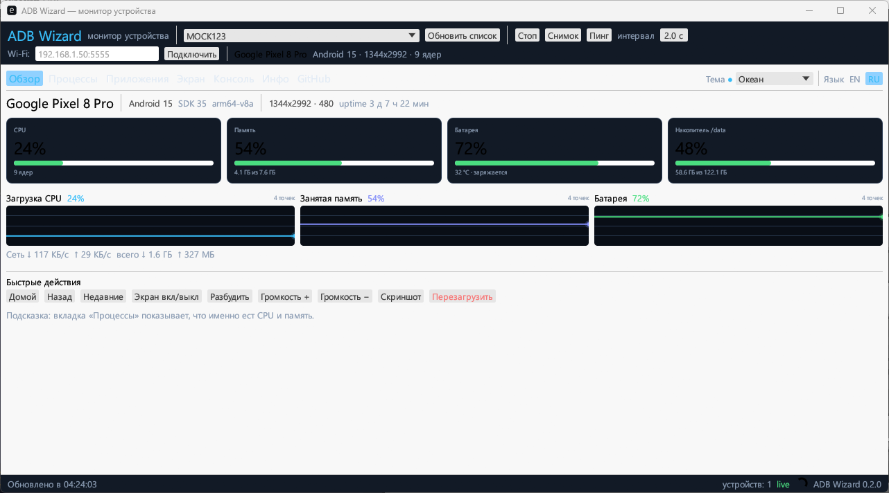
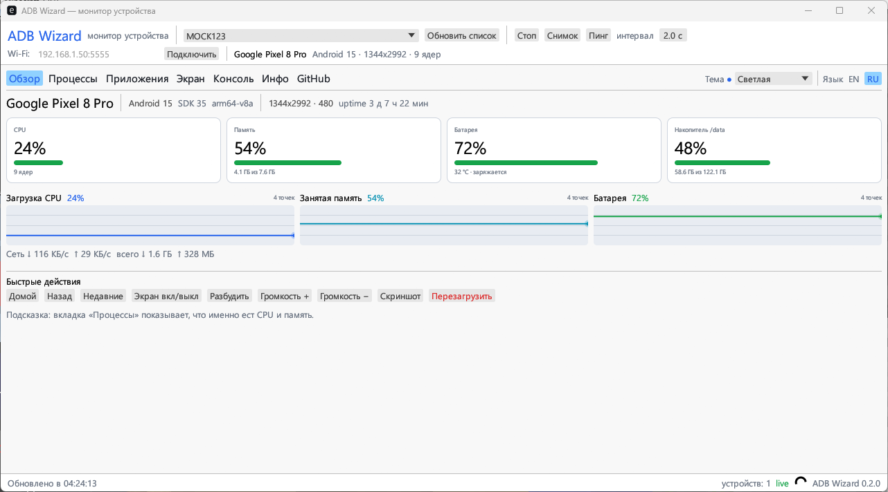

<div align="center">

# ⚡ ADB Wizard

**Монитор Android-устройства через ADB — нагрузка, приложения, экран и консоль в одном окне.**

[](https://github.com/AmazingCoderA/adb-wizard/releases/latest)
[](https://github.com/AmazingCoderA/adb-wizard/actions/workflows/ci.yml)
[](https://www.rust-lang.org/)
[](https://github.com/emilk/egui)
[](LICENSE)

[English version](README.md) · [Возможности](#-возможности) · [Темы](#-темы) · [Быстрый старт](#-быстрый-старт) · [Публикация](#-публикация-на-github)

</div>

---

**ADB Wizard** — лёгкое нативное приложение на Rust, которое показывает, что происходит с Android-устройством прямо сейчас: загрузку CPU, память, батарею, накопитель, сеть, топ процессов, экран телефона с управлением касанием и консоль `adb shell`. Без веб-интерфейса и тяжёлых зависимостей — один исполняемый файл.



> На скриншотах — демонстрационное устройство (mock ADB), а не реальный телефон.

## 📥 Скачать

| ОС | Файл |
|---|---|
| **Windows 10/11** (x86_64) | [adb-wizard-windows-x86_64.exe](https://github.com/AmazingCoderA/adb-wizard/releases/latest/download/adb-wizard-windows-x86_64.exe) |
| **Linux** (x86_64) | [adb-wizard-linux-x86_64](https://github.com/AmazingCoderA/adb-wizard/releases/latest/download/adb-wizard-linux-x86_64) |
| **macOS** (Apple Silicon) | [adb-wizard-macos-aarch64](https://github.com/AmazingCoderA/adb-wizard/releases/latest/download/adb-wizard-macos-aarch64) |
| **macOS** (Intel) | [adb-wizard-macos-x86_64](https://github.com/AmazingCoderA/adb-wizard/releases/latest/download/adb-wizard-macos-x86_64) |
| **FreeBSD** (best-effort) | [adb-wizard-freebsd-x86_64](https://github.com/AmazingCoderA/adb-wizard/releases/latest/download/adb-wizard-freebsd-x86_64) |

Все сборки делает GitHub Actions из исходников тега. FreeBSD собирается по возможности и может отсутствовать в некоторых релизах.

## ✨ Возможности

| | |
|---|---|
| 📊 **Обзор** | Настоящая загрузка CPU по дельтам `/proc/stat`, RAM, батарея (уровень, температура, статус), `/data`, uptime, скорость сети и живые графики |
| 🔥 **Процессы** | Кто ест CPU (`dumpsys cpuinfo`) и память (`dumpsys meminfo`, PSS) — с наглядными полосами |
| 📦 **Приложения** | Список пользовательских приложений с поиском; настройки, остановка, очистка данных, отключение/включение, удаление и `dumpsys package` |
| 📱 **Экран** | Живая трансляция экрана (интервал 150–3000 мс), управление касанием, «Домой / Назад / Недавние», сохранение PNG |
| 🎛️ **Свои кнопки** | Добавление, редактирование и удаление кнопок с любой командой `adb shell`; пресеты Play/Pause, Menu, Camera, громкость |
| ⌨️ **Консоль** | Полноценный `adb shell` с историей вывода и быстрыми командами (батарея, память, пакеты, логи, свойства, диск, топ CPU) |
| 🧾 **Тех. информация** | `getprop`, `ip addr`, `df`, `uname`, батарея, дисплей и CPU в одном дампе |
| 📶 **Пинг** | Round-trip до ADB и пинг из телефона в интернет (`8.8.8.8`) одной кнопкой |
| 🚀 **GitHub** | Публикация проекта одной кнопкой через GitHub CLI (`gh`) |
| 🎨 **Темы и языки** | Пять палитр с акцентами и переключение русского/английского интерфейса |

## 🎨 Темы

Переключаются в правом верхнем углу строки вкладок. Акцентный цвет меняет заголовок, активную вкладку, графики, полосы процессов и главные кнопки.

| Тема | Акцент | Настроение |
|---|---|---|
| **Графит** | `#FF9800` оранжевый | тёплый тёмный интерфейс по умолчанию |
| **Океан** | `#38BDF8` небесно-голубой | холодный тёмно-синий |
| **Изумруд** | `#34D399` мятно-зелёный | спокойный тёмно-зелёный |
| **Фиалка** | `#A78BFA` лавандовый | контрастный фиолетовый |
| **Светлая** | `#2563EB` синий | светлая тема для яркого дня |

<p align="center">
  
  
</p>

## 🚀 Быстрый старт

### Готовый файл

1. Скачайте сборку для своей ОС из [Releases](https://github.com/AmazingCoderA/adb-wizard/releases/latest).
2. Убедитесь, что `adb` доступен в `PATH` (или задайте переменную `ADB`).
3. Подключите телефон по USB с включённой отладкой и запустите приложение.

### Из исходников

```bash
git clone https://github.com/AmazingCoderA/adb-wizard.git
cd adb-wizard
cargo run --release
```

Готовый бинарник появится в `target/release/`.

Если `adb` лежит не в `PATH`, укажите путь явно:

```powershell
$env:ADB = "C:\platform-tools\adb.exe"
cargo run --release
```

```bash
export ADB=/opt/android-sdk/platform-tools/adb
cargo run --release
```

## 📋 Требования

- **Windows 10/11**, **Linux** (X11/Wayland), **macOS** или **FreeBSD**.
- **Rust** stable, edition 2021.
- **[Android SDK Platform-Tools](https://developer.android.com/tools/releases/platform-tools)** — `adb` в `PATH`.
- На телефоне: «Для разработчиков» → «Отладка по USB», подтвердить ключ на компьютере.
- Для публикации: [Git](https://git-scm.com/downloads) и [GitHub CLI](https://cli.github.com/), авторизованный через `gh auth login`.

Зависимости сборки на Linux (Debian/Ubuntu):

```bash
sudo apt-get install libxcb-render0-dev libxcb-shape0-dev libxcb-xfixes0-dev \
  libxkbcommon-dev libgl1-mesa-dev
```

## 🕹️ Как пользоваться

1. Подключите телефон по USB и включите отладку.
2. Запустите приложение — устройство появится в списке, мониторинг стартует сам.
3. **Процессы** показывают, что ест CPU и память.
4. **Приложения** — поиск, просмотр и управление пользовательскими приложениями.
5. **Экран** — трансляция экрана; включите **Управление касанием**, чтобы кликать по телефону из окна.
6. **Инфо** — полный технический дамп, пинг до устройства и до интернета.
7. **Консоль** — любые команды `adb shell`, например `dumpsys battery` или `logcat -d -t 200`.
8. **GitHub** — публикация проекта в один клик.

### 📶 Подключение по Wi-Fi

Один раз по USB:

```bash
adb tcpip 5555
```

Дальше в приложении введите `IP_ТЕЛЕФОНА:5555` и нажмите «Подключить». Телефон и компьютер должны быть в одной сети. На Android 11+ для беспроводной отладки может понадобиться `adb pair`.

## 🐙 Публикация на GitHub

Вкладка **GitHub** → имя репозитория → **«Опубликовать на GitHub»**.

Что делает кнопка:

1. `git init -b main`, если репозитория ещё нет.
2. `git add -A` и коммит.
3. `gh repo create <имя> --public/--private --source . --remote origin --push`.
4. Показывает ссылку на созданный репозиторий.

Авторизация — любым из двух способов:

- выполнить `gh auth login` один раз в терминале;
- вставить Personal Access Token с правом `repo` в поле **Токен GitHub** (токен хранится только в памяти и не пишется на диск).

Приложение ищет `gh` в `PATH`, в `%LOCALAPPDATA%\Programs\GitHub CLI\bin\gh.exe`, в `%ProgramFiles%\GitHub CLI` и рядом с исполняемым файлом. Если `gh` не установлен, приложение всё равно подготовит локальный git-репозиторий и покажет инструкции. Кнопка «Создать токен» открывает страницу GitHub с уже выбранным scope `repo`.

## 🧱 Структура проекта

```
src/
  main.rs      — запуск окна и настройки viewport
  app.rs       — интерфейс egui, темы, вкладки и состояние приложения
  adb.rs       — запуск adb, сбор снимка, скриншоты, фоновый монитор
  parsers.rs   — парсеры вывода Android + unit-тесты
  i18n.rs      — русские и английские строки
  publish.rs   — git/gh публикация
.github/
  workflows/ci.yml      — тесты и сборка на Windows, Linux, macOS, FreeBSD
  workflows/release.yml — мультиплатформенные ассеты релиза по тегу
```

## 🩺 Диагностика

- **adb не найден** — добавьте platform-tools в `PATH` или задайте `ADB`.
- **unauthorized** — подтвердите запрос отладки на экране телефона.
- **offline** — переподключите кабель, выполните `adb kill-server` и `adb start-server`.
- **Нет данных CPU/памяти** — некоторые прошивки ограничивают `dumpsys`; попробуйте команды из вкладки «Консоль» вручную.
- **Скриншот не снимается** — приложение автоматически пробует запасной способ через `/sdcard`.
- **Экран моргает после команды** — проверьте, не переключает ли экран ваша кнопка или команда (`input keyevent 26`), и приложите точную команду к issue.

## 📄 Лицензия

[MIT](LICENSE)
